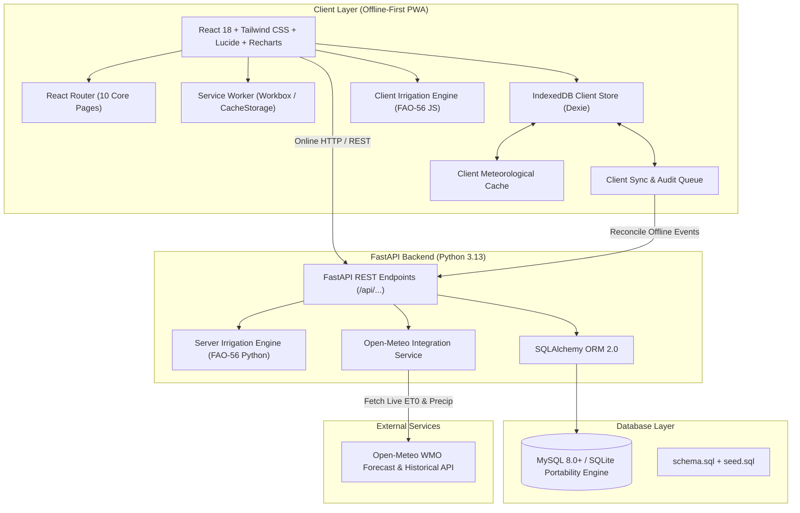

# ARVA System Architecture

**ARVA — Predict. Prioritize. Preserve.**  
*Smart Water Tank and Adaptive Irrigation Scheduler based on FAO-56 Soil-Water Balance*

---

## 1. High-Level Architectural Diagram

---

## 2. Key Architectural Decisions

### A. Dual Engine Pattern for Offline Autonomy
The mathematical core of ARVA is implemented identically in:
1. `frontend/src/engine/irrigationEngine.js` (Client-side JavaScript)
2. `backend/app/services/irrigation_engine.py` (Server-side Python)

This guarantees that a farmer in a remote rural field with no mobile cellular reception can perform full 7-day soil water balance projections, inspect water shortages, and adjust irrigation recommendations offline.

### B. Graceful Degradation & Fallback Strategy
- **Weather Service:** If Open-Meteo is unreachable or the device is offline, ARVA loads the most recent cached meteorological forecast from IndexedDB. If no cache exists, it falls back to a deterministic regional agro-climatic baseline.
- **Database Engine:** The backend connects to MySQL by default. If MySQL is not running on the evaluator's machine, it automatically falls back to an embedded SQLite database (`arva.db`) without throwing unhandled exceptions.

### C. Zero-Conflict Change Synchronization
When actions (e.g. creating a zone, updating moisture, completing an irrigation cycle) are performed offline:
1. Records are assigned client UUIDs and persisted immediately in IndexedDB.
2. The action is recorded in `syncQueue`.
3. When network connectivity is restored, the client posts the batch to `/api/sync`.
4. The server merges events using idempotent keys (`UUID`), preventing duplicates.
